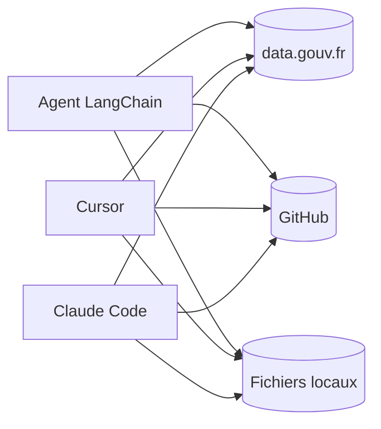
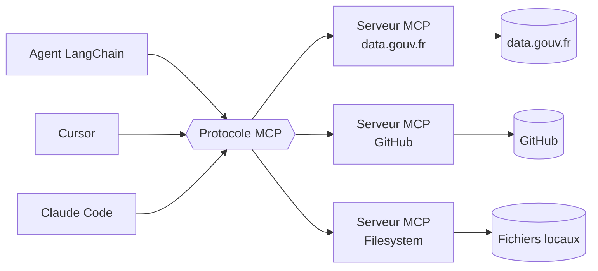
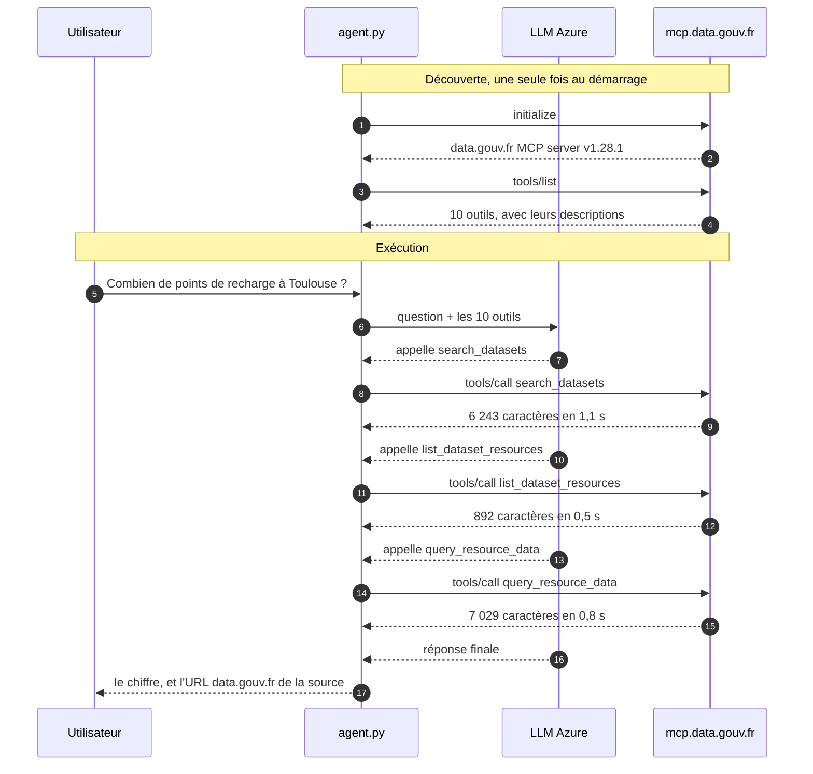

# Schémas d'introduction — MCP

Supports à projeter pendant les 45 premières secondes de la démonstration.

## 1. Le problème : N × M intégrations

Chaque client doit écrire un connecteur pour chaque source de données.
Trois clients et trois sources, c'est déjà **neuf connecteurs** à écrire et à maintenir.

## 2. La solution : N + M

Chaque client parle **un seul protocole**. Chaque source expose **un seul serveur**.
Trois clients et trois sources : **six branchements**, et chaque nouveau client
bénéficie immédiatement de toutes les sources existantes.

## 3. Ce qui se passe réellement pendant la démo

Le serveur n'expose pas seulement des outils : il expose aussi **leur mode d'emploi**,
que le modèle lit avant de décider.

## Le chiffre à retenir

La ressource interrogée compte **233 972 lignes** pour **157 Mo**.
Elle n'est **jamais téléchargée** : le serveur MCP interroge l'API Tabular
et ne renvoie que ce qui est demandé, en moins d'une seconde.
